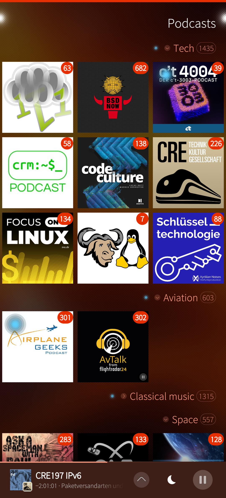
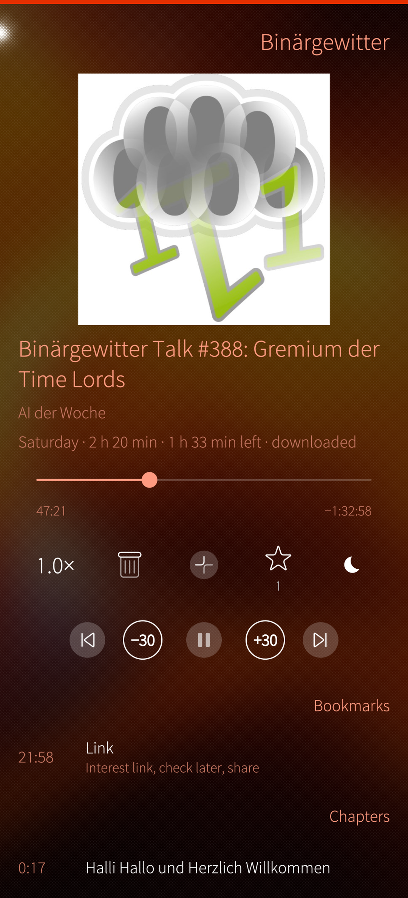
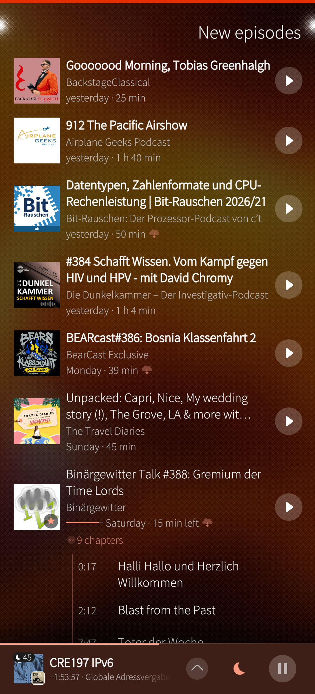
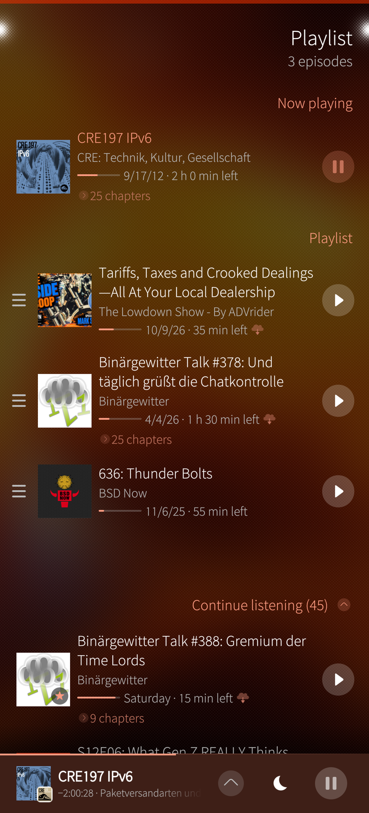
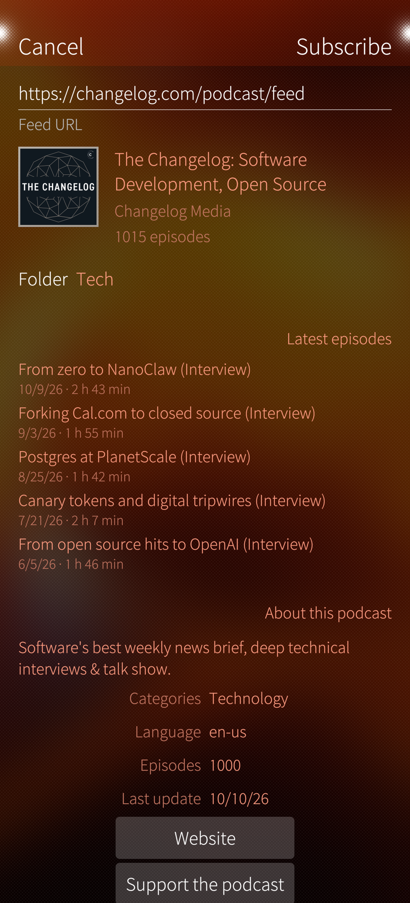
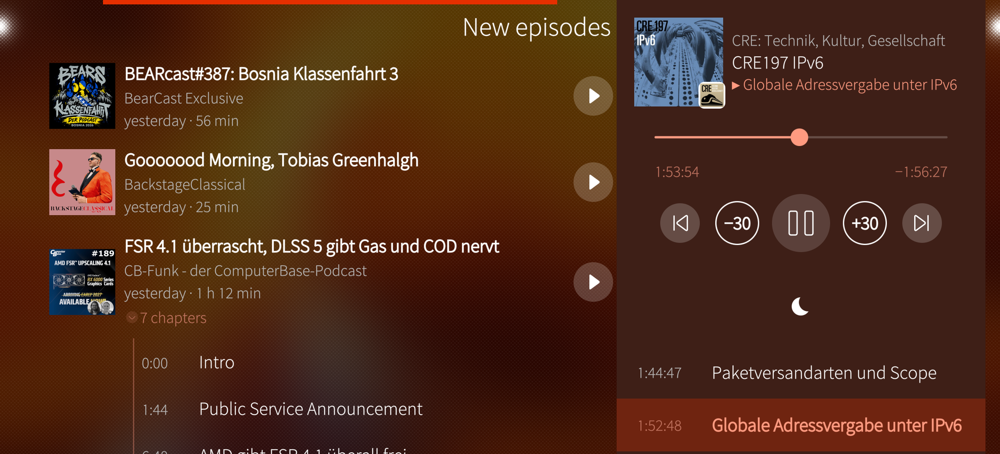
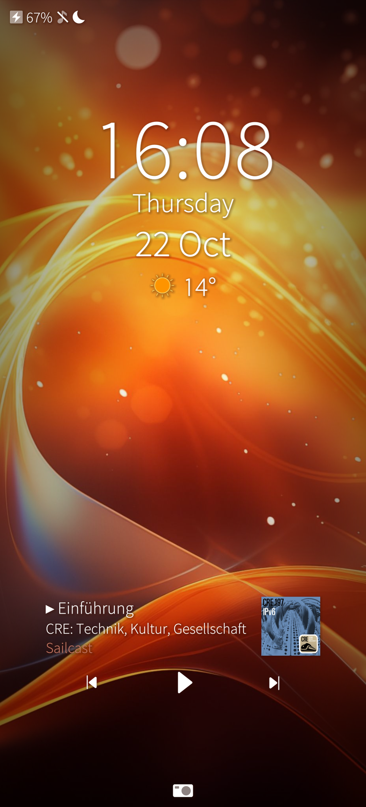

# Sailcast

Podcast app for Sailfish OS with a native C++ core. Subscriptions and the
listening state are synchronized with other podcast apps (e.g. AntennaPod on
Android) through a Nextcloud with the app **GPodder Sync** or a gpodder.net
compatible server.
<p>





</p>
<p>


</p>

## Features

- **New episodes, Podcasts, Playlist** as three pages to swipe between (start page selectable)
- **Folders** for podcasts – collapsible, in the grid and the list, kept in OPML exports
- **Podcast search** through [Podcast Index](https://podcastindex.org) with
  details (description, categories, website), or add a feed address (checked
  before subscribing; an address in the clipboard is filled in)
- **Playlist** with drag sorting, "Now playing" and "Continue listening"
- **Player** on the episode page with a labelled toolbar (speed, download,
  playlist, bookmark, sleep timer): chapters (Podlove and `podcast:chapters`),
  skip times; lock screen, cover and headset controls; in landscape the
  player is a column on the right
- **Bookmarks** with notes – places in an episode to come back to
- **Per podcast:** own speed, skip intro and outro, left out of the automatic
  update if wanted (also per folder), login for premium feeds
- **Downloads** with resume, only on Wi-Fi, automatic downloads of new
  episodes, clean-up of played downloads
- **Archive** a podcast completely into `~/Music/Podcasts/<Podcast>/` (episodes,
  feed, cover, metadata) – readable without Sailcast, importable again
- **Sync** of subscriptions and listening state (Nextcloud GPodder Sync with
  sign-in in the browser, gpodder.net API and compatible servers such as
  oPodSync). Folders, bookmarks, the playlist and per-podcast settings stay on
  the phone (the sync APIs have no place for them)
- **Import/export:** OPML, gpodder-sailfish database, Sailcast database backup
- Broken feeds (HTML entities, bare `&`) are repaired; private feed tokens are
  hidden in messages

## Setting up the sync with Nextcloud

1. In your Nextcloud: install the app **GPodder Sync** (Apps → search
   "GPodder Sync").
2. In Sailcast: Settings → Synchronization → server type "Nextcloud", your
   server address → **"Sign in with the browser"**: confirm in the browser,
   Sailcast receives an app password and synchronizes. (Or enter user name and
   an app password from Nextcloud → Settings → Security by hand.)

The first sync takes over the subscriptions and listening states of the server
(nothing on the server is overwritten). AntennaPod can use the same account
(Settings → Synchronization → "Nextcloud").

## Archive and cloud backup with rclone (optional)

Backup to the cloud and streaming from there are left to
[rclone](https://rclone.org) – Sailcast itself contains no cloud code.

1. Set up a remote once (Google Drive, Nextcloud via WebDAV, …): `rclone config`
2. Back up the archive: `rclone copy ~/Music/Podcasts <remote>:Podcast-Archive`
3. Stream from the cloud: run
   `rclone serve http <remote>:Podcast-Archive --addr 127.0.0.1:8080 --read-only`
   on the phone and set Settings → Archive → cloud archive address to
   `http://127.0.0.1:8080/`. Sailcast plays an episode from the local file, the
   original address or – if both are gone – from the cloud archive.

## Building

**App:** open `harbour-sailcast.pro` in the Sailfish SDK (Qt Creator), or run
`./build-release.sh` for release packages of all architectures.

**Podcast search key:** the search needs a Podcast Index API key (free at
[api.podcastindex.org](https://api.podcastindex.org)). Copy
`podcastindex.pri.example` to `podcastindex.pri` and fill in key and secret
(the secret hex-encoded, see the file). Without it the app builds, only the
search is not available. Never publish `podcastindex.pri`.

**Test tool on the desktop** (Arch/CachyOS: `sudo pacman -S qt5-base`):

```
cd cli
qmake-qt5
make -j$(nproc)
./sailcast-cli --help
```

## Structure

| Folder | Content |
|---|---|
| `core/` | libsailcast: database, feed parser and updater, OPML, importers, sync, downloads, archive, search. Only QtCore, QtNetwork, QtSql. |
| `cli/` | `sailcast-cli`, a desktop tool to test the core. Not part of the package. |
| `src/` | App start-up, `AppCore` (the core for QML), list models, image cache, Sailfish-specific helpers. |
| `qml/` | Silica user interface and player. |
| `testdata/` | Sample feeds for the tests. Not part of the package. |

Design decisions: [`DESIGN.md`](DESIGN.md); changes:
[`CHANGELOG.md`](CHANGELOG.md).

## Privacy

See [`PRIVACY.md`](PRIVACY.md).

## License

GPL-3.0-or-later, see [`LICENSE`](LICENSE). © 2026 Thomas Sappl.
